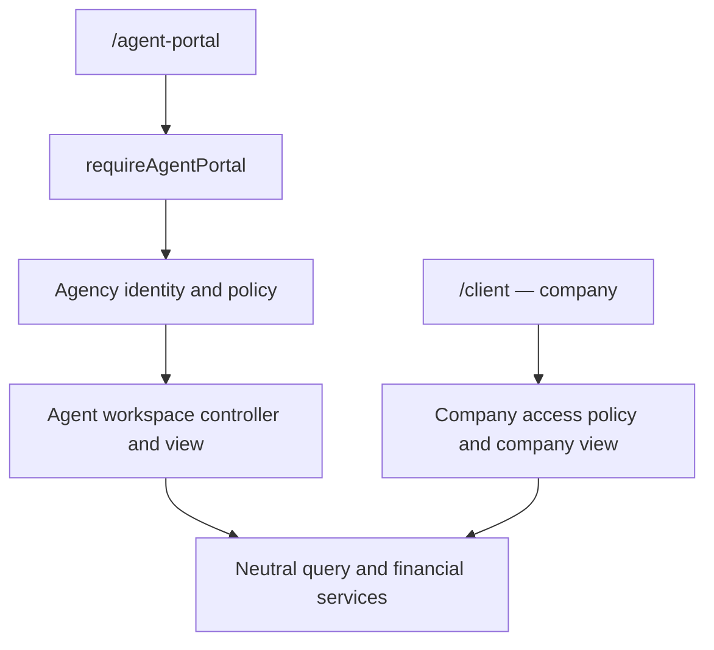

# Agent Portal Structure

## Request flow

1. `routes/agentPortal.js` owns `/agent-portal`. Company and retail routes remain
   under `/client`. `legacyAgentPortal` redirects old agency page URLs and routes
   cached agency API requests through the agency boundary.
2. `middlewares/clientPortalAuth.js` checks the session, MFA enrollment, account
   status, session version and the active agency parent. Agency tenant checks
   are strict in multi-tenant mode; single-tenant legacy behavior is retained.
3. `services/agentPortalAccessService.js` reloads the actor and owning agency.
   A preloaded account must match the session ID. An agency staff account cannot
   impersonate an owner by changing its role to `agent`.
4. `utils/agentPortalPolicy.js` resolves agency capabilities. Company capabilities
   remain owned by `companyAccessService`; neither policy imports the other.
5. `services/agentTransactionScopeService.js` builds the shared agency ownership
   boundary used by reports, transaction details, receipts and legacy dashboards.
6. `controllers/agent/workspaceController.js` calls `agentPortalWorkspaceService`
   and renders only `views/agent/workspace.ejs`. The company document lives in
   `views/company/workspace.ejs`. Both reject a workspace from the other portal.

## Handler ownership

`controllers/clientAgentController.js` is a small compatibility facade. Existing
routes and imports remain stable while implementation lives in:

| File | Responsibility |
| --- | --- |
| `controllers/agent/dashboardController.js` | Legacy dashboard rendering |
| `controllers/agent/staffController.js` | Staff creation, suspension and password reset |
| `controllers/agent/registrationController.js` | HTTP registration-review responses |
| `services/agentPortalContextService.js` | Legacy page queries and presentation context |
| `services/agentRegistrationService.js` | Shared web/mobile registration approval and rejection |

`businessPortalService` and `clientWorkspaceController` are compatibility
facades. Their implementations are split across `services/portalWorkspace/`
and `controllers/portalWorkspace/`, by catalog, access, navigation, transactions,
customers, balances, finance, reports, settings and page composition. The page
composition module receives the workspace and page policy explicitly; the
agency entrypoint does not use company authentication to resolve its actor.

`routes/portal/` contains six shared API groups: support, notifications, theme,
service requests, rate alerts and web push. The agency router mounts these only
after its agency guard. It does not expose company staff administration or
company PDF endpoints. Financial commands reuse neutral services instead of
copying ledger or pricing logic into portal-specific controllers.

## Security and transaction rules

- Check capabilities on the server, independently of hidden controls or links.
- The canonical namespace retains CSRF and operation-PIN checks. Emergency
  lockdown covers financial mutations under both the new and legacy URLs.
- Reject unknown roles. Accountants cannot send transfers, including when
  customer-management capability has been delegated to them.
- Staff without agency-wide reporting permission only see their own operations.
  Explicit `canViewAllReports` allows agency-wide reporting, without granting
  customer or staff administration.
- Keep the owning agency and tenant conditions when adding report filters.
  A phone identity alone is insufficient in multi-tenant mode.
- Legacy transactions without `clientActorId` retain the existing name fallback
  inside the agency scope. Newly created transfers must store the actor ID.
- Changing a password or staff status increments `sessionVersion`. Browser and
  mobile authentication must compare it against the current database account.
- Deleted staff cannot be reactivated through the suspension endpoint. The
  inactive staff filter covers both `inactive` and legacy `banned` statuses.
- Registration approval, customer creation and account-code reservation commit
  together. Approval and rejection both consume only a `pending_agent` request
  owned by that agency. Registration approval requires MongoDB transactions
  (replica set or a transaction-capable cluster); there is no partial-write
  fallback. Existing deleted-identity credential archival still runs through the
  shared registration-identity service before account creation.
- Preserve passwords exactly. New staff passwords must contain 8–128 characters.
  Do not put passwords, tokens or MFA secrets in page bootstraps or audit data.

## Browser code

`public/js/business-portal/api-response.js` owns response parsing and explicit MFA
errors. Load it before `client-workspace.js`. A financial mutation requires an
explicit success response; empty, HTML and scalar responses cannot confirm it.
Keep the idempotency key when the outcome cannot be confirmed.

`public/js/business-portal/rate-notice.js` owns countdown state in a closure. It
retains the initial rate description and clears cancelled schedules.

`public/js/agent-portal/index.js` boots the agency portal only. The old company
entrypoints are inert on an agency document. Agency pages use `window.agentPortal`
and `data-agent-shell`; company pages use their own bootstrap and shell marker.

The old 1,900-line browser workspace is split into native ES modules under
`public/js/portal-workspace/`: core, shell, service fields, smart transfer,
assistant, transfer confirmation/submission, balance transfers, receipts, support,
notices, tools and reports. Company header and presentation entrypoints are thin
compatibility loaders for the neutral components. Native module caching prevents
duplicate initialization when compatibility entrypoints coexist.

All agency API calls are scoped through `portalFetch` to `/agent-portal`.
Theme storage uses `ahram_agent_theme`, independently of company theme storage.
Assistant drafts and agency preferences include actor/agency scope.

`views/portal/` and `public/css/portal-shell/` form a neutral presentation kit.
Existing client partials and CSS URLs are compatibility aliases, not copied
implementations. Shared components rewrite their links using the owning portal
base path. Agency pages never load company JavaScript or CSS entry URLs. Legacy
`cp`/`cm` component class names are design-system identifiers, not authority rules.

## Checks

- `npm run check:agent`: scoped lint, formatting, architecture, TypeScript and
  agency/shared-client regression suites.
- `npm run test:agent`: filename-selected suites with isolated test secrets.
  MongoDB integration tests use an ephemeral local replica set.
- `npm run check:agent-browser`: Chrome rendering checks for allowed role/page
  combinations at mobile and desktop widths. Uses local fixtures and mock API
  responses; also verifies retry after an invalid response, CSRF forwarding,
  duplicate-click protection and reuse of the idempotency key. It never sends
  production transfers.
- `npm run check:portal-isolation-browser`: opens agency and company tabs in the
  same browser context and verifies independent themes, storage and API paths.
- Set `PUPPETEER_EXECUTABLE_PATH` when using an existing Chrome installation.
  Optionally pass an output directory to `scripts/checkAgentPortalBrowser.js`.

## Deployment and remaining boundaries

The native browser modules require a browser with dynamic-import support. The
Chrome checks exercise their initialization, not just template compilation.
TypeScript checks the existing `src` boundary, not all legacy JavaScript.

Deploy the new modules, views and compatibility files together. Reuse the current
financial-service settings; no balance migration or historical rewrite is part
of this change. Approval still requires transaction-capable MongoDB.

Local fixtures and regression tests do not replace deployment checks, real
provider verification or production load testing. Run production readiness and
MongoDB transaction checks before deploying.

## Credential and status concurrency

Agent password writes and staff status changes belong to
`services/agentCredentialService.js`. The service only accepts User agents and
AgentEmployee identities; it never updates company credentials. Staff writes
include the owning agency and exclude deleted records at write time.

Password rotation hashes once before a single atomic database update, increments
the persisted session version, and removes refresh credentials and pending OTP
challenges. Self-service changes compare the verified previous hash at write
time, so a concurrent administrative reset cannot be overwritten with stale
credentials. The current browser receives the version returned by MongoDB.

Staff forms submit the desired next status. Repeating a suspension leaves the
account suspended; a stale status update cannot revive a deleted record. Pending
authentication credentials are removed when suspending staff.

Feedback redirects accept local client/agent portal paths only, preserving query
filters and fragments while rejecting external destinations. MongoDB regression
tests reproduce the original races using synchronized reads, then assert the
persisted state after real concurrent controller calls.

## Agency daily operations on phones

The agency transactions screen always queries the current Libya calendar day
using createdAt. Owner roles, date parameters and history=all cannot widen this
screen. Counts and totals use the same filter as the rows; historical searches
remain in reports. Company transaction date behavior is unchanged.

The agent-only daily_transactions partial supplies phone cards below 768px;
the desktop table stays available above that width. Cost fields still obey
canViewBalance. Agent-only CSS and receipt-share.js are loaded through the agency
entrypoint, with no company entrypoint changes.

Sharing fetches the authenticated receipt proxy and sends an image File through
Web Share, so the recipient receives an actual image instead of a private URL.
The user selects WhatsApp from the phone's share sheet. SVG receipts become PNG.
If file sharing is unsupported, the image is downloaded for manual attachment.
Slow downloads and permission errors retain the prepared file for another tap;
cancellation is silent and expired sessions/HTML responses are not shared.
Native sharing depends on a supporting mobile browser and HTTPS. The browser
checks simulate the native share API; they do not send messages to WhatsApp.

Validation: 339 automated cases in 42 suites, 32 daily mobile browser checks at
320/390/430/1440px, and 4 company/agency isolation scenarios. Run the dedicated
browser checks with npm run check:agent-daily-browser.
